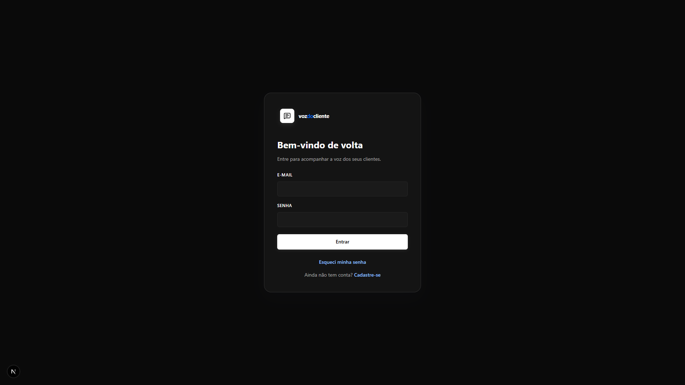
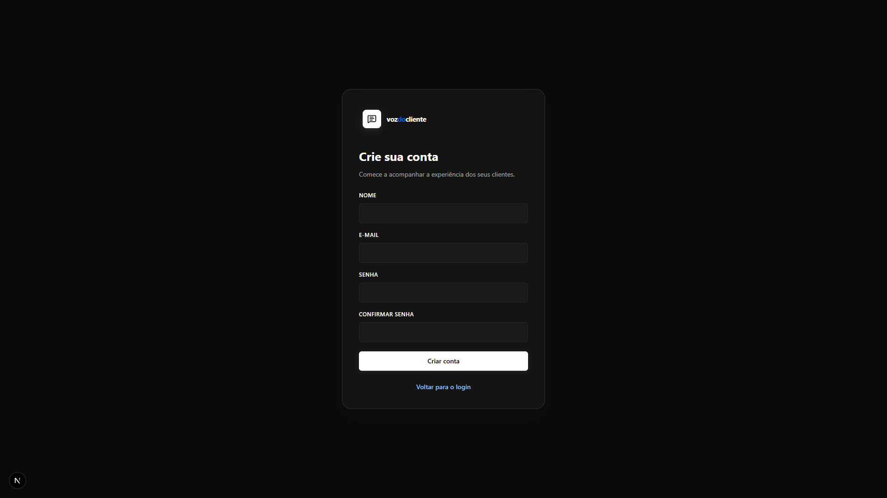
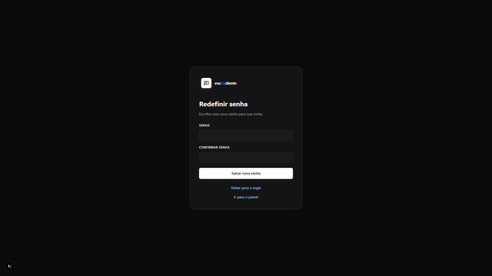
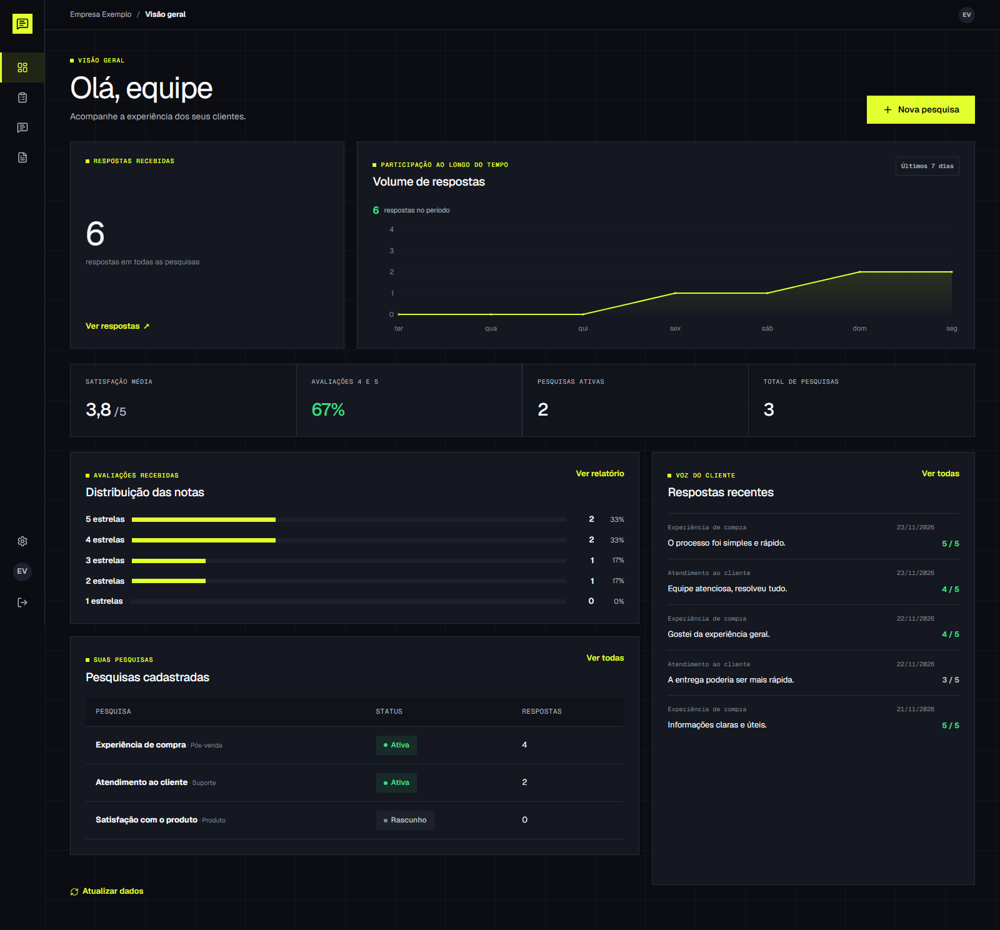
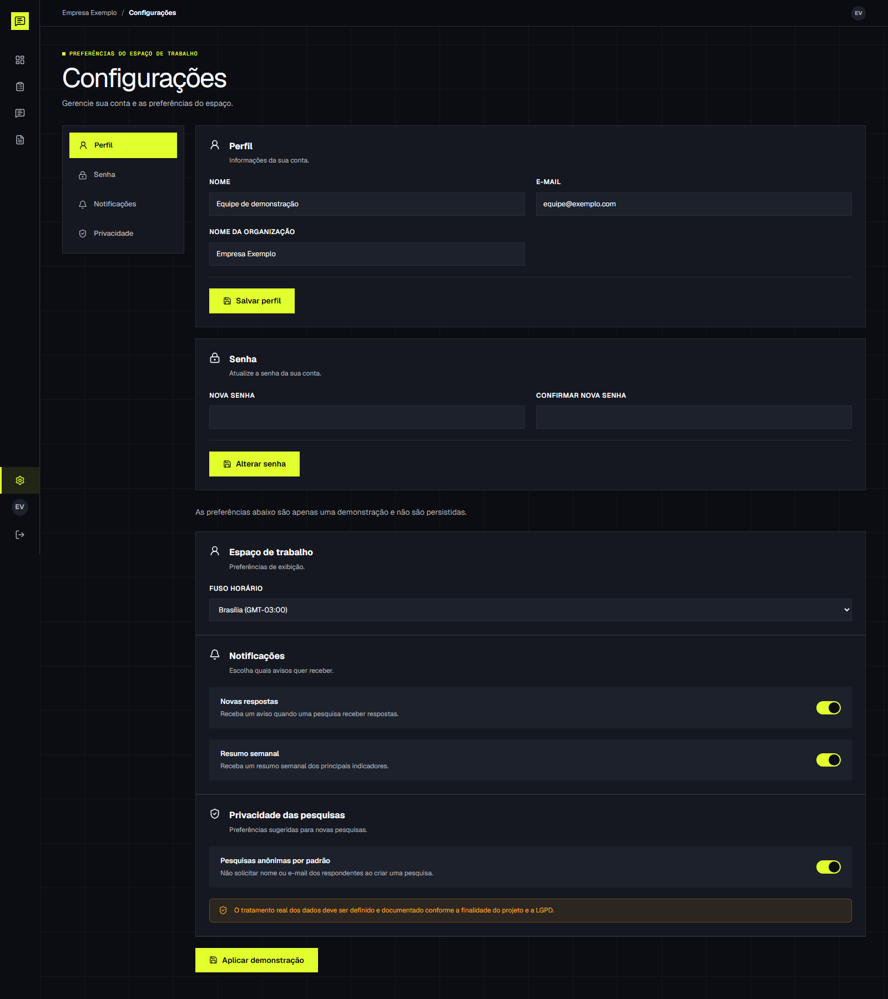

# Voz do Cliente

Plataforma para criar pesquisas de satisfação, compartilhar formulários públicos e acompanhar respostas e indicadores. O proprietário gerencia suas pesquisas em um painel autenticado; os clientes respondem por um link, sem precisar criar uma conta.

Novas pesquisas usam uma nota obrigatória de 1 a 5 e um comentário opcional. O painel apresenta as respostas e os relatórios descritos abaixo; atualmente não há análise automática dos comentários.

## Tecnologias

- **Aplicação e API:** Next.js, React e TypeScript.
- **Autenticação e banco de dados:** Supabase Auth e PostgreSQL, com políticas de acesso RLS.
- **Proteção dos envios públicos:** Cloudflare Turnstile, validado no servidor.
- **Interface e indicadores:** Tailwind CSS e Recharts.

## Executar localmente

Pré-requisitos: Node.js 22.18 ou superior, npm, um projeto Supabase configurado e um widget Cloudflare Turnstile.

1. Na raiz do projeto, instale as dependências:

```bash
npm ci
```

2. Copie `.env.example` para `.env.local` e preencha as configurações do Supabase, a origem do site e as chaves do Turnstile. Para uso local, configure `SITE_URL` como `http://localhost:3000` e autorize `localhost` no widget.
3. Configure a autenticação e aplique as migrações no projeto Supabase correto, conforme [Login e gerenciamento de conta](#login-e-gerenciamento-de-conta) e [Banco de dados](#banco-de-dados).
4. Inicie o servidor:

```bash
npm run dev
```

Abra [http://localhost:3000](http://localhost:3000), crie uma conta e confirme o e-mail. No painel, crie e ative uma pesquisa para compartilhar seu link. Endereços `localhost` só são acessíveis no próprio computador; para compartilhamento público, é necessário hospedar a aplicação.

Não compartilhe `.env.local` nem as chaves secretas. A chave secreta do Supabase e a do Turnstile são usadas somente no servidor.

## Documentação

- [Integração com Supabase e proteção dos envios](docs/SUPABASE_INTEGRATION.md).
- [Referência da API](docs/API_DOCUMENTATION.md).
- [Índice dos demais documentos](docs/ÍNDICE.md). Alguns documentos descrevem propostas ou estados anteriores do projeto; confira suas datas e limitações.

## Telas da aplicação

As capturas abaixo mostram uma versão anterior do visual; a interface atual usa o tema escuro com detalhes em verde-limão.

### Login

<p align="center">
  
</p>

*A tela de login permite entrar com e-mail e senha, recuperar a senha ou acessar o cadastro.*

### Cadastro

<p align="center">
  
</p>

*A tela de cadastro reúne nome, e-mail, senha e confirmação de senha para criar uma conta.*

### Recuperação de senha

<p align="center">
  
</p>

*A tela de recuperação de senha solicita o e-mail cadastrado e envia um link para redefinição.*

### Redefinição de senha

<p align="center">
  
</p>

*A tela de redefinição permite informar uma nova senha e confirmá-la antes de salvar.*

### Visão geral

<p align="center">
  
</p>

*A visão geral apresenta indicadores e pesquisas cadastradas pela conta.*

### Pesquisas

<p align="center">
  
</p>

A aba **Pesquisas** permite buscar por nome ou categoria, filtrar por status e acompanhar o número de respostas.

#### Criar e publicar

1. Clique em **Nova pesquisa**, informe o nome e a categoria e crie o rascunho. O nome informado aparece como título no formulário público.
2. Em **Gerenciar**, personalize as duas perguntas criadas automaticamente: uma avaliação obrigatória de 1 a 5 e um comentário opcional. Salve cada pergunta separadamente. Escreva a pergunta de avaliação de modo que 1 represente a pior experiência e 5 a melhor.
3. Clique em **Ativar pesquisa** e use **Copiar link** para compartilhar o formulário. O link de um rascunho ou de uma pesquisa encerrada não recebe respostas. O envio exige a verificação de segurança configurada.

O nome da pesquisa só pode ser definido na criação pelo painel; atualmente não há opção na tela para alterá-lo depois. A API permite atualizar o título, inclusive após receber respostas. A categoria também é informada na criação.

#### Alterações e versões

- Antes da primeira resposta, o criador pode alterar os textos das perguntas padrão, mas não seus tipos, ordem ou obrigatoriedade.
- Após a primeira resposta, as perguntas ficam bloqueadas. **Criar nova versão** abre um novo rascunho, com outro link e sem as respostas anteriores; a pesquisa original e seu histórico são preservados. A versão original não é encerrada automaticamente.
- Pesquisas antigas mantêm seus tipos de pergunta. Ao criar uma nova versão de uma pesquisa antiga, o formulário passa a ser padrão: copia a primeira pergunta de avaliação e a primeira de texto, quando existirem; outras perguntas não são copiadas.
- Uma pesquisa ativa pode ser encerrada e posteriormente reativada pelo painel.

#### Cálculo dos resultados

Cada envio do formulário padrão contém uma **nota obrigatória de 1 a 5** e pode conter um **comentário opcional**, de até 4.000 caracteres, incluindo espaços. A nota 1 representa a pior avaliação e 5, a melhor. O comentário é armazenado junto ao envio, mas não entra nos cálculos numéricos.

Os indicadores gerais usam os dados das pesquisas da conta, independentemente do status, incluindo pesquisas antigas e versões separadas. Cada nota recebida tem o mesmo peso: não é feita uma média das médias de cada pesquisa. Em pesquisas antigas com mais de uma pergunta de avaliação, cada nota conta separadamente; por isso, o número de notas pode ser diferente do número de envios.

**Fórmulas dos indicadores gerais:**

- **Total de respostas:** número de envios registrados, contando cada formulário enviado uma vez.
- **Satisfação média:** soma de todas as notas válidas ÷ quantidade de notas válidas. A tela apresenta o resultado de 1 a 5, com no máximo uma casa decimal. Sem notas, mostra `—`.
- **Avaliações 4 e 5:** (quantidade de notas 4 ou 5 ÷ quantidade total de notas) × 100, arredondada para o inteiro mais próximo. É uma classificação pela nota, não uma análise de sentimento do comentário. Sem notas, mostra `—`.
- **Distribuição de cada nota:** para cada valor de 1 a 5, conta-se quantas vezes ele foi recebido. O percentual é (quantidade daquela nota ÷ quantidade total de notas) × 100, arredondado para o inteiro mais próximo. Sem notas, as barras mostram contagem e percentual zero. Como os percentuais são arredondados individualmente, sua soma pode não ser exatamente 100%.
- **Volume diário:** quantidade de envios registrados em cada dia dos últimos sete dias, incluindo o dia atual, considerando o horário local do navegador. O total do período é a soma das contagens desses sete dias.

**Exemplo:** para cinco envios com notas `5, 5, 4, 3, 1`:

- Total de respostas: **5**.
- Média: `(5 + 5 + 4 + 3 + 1) ÷ 5 = 3,6 / 5`.
- Avaliações 4 e 5: `(3 ÷ 5) × 100 = 60%`.
- Distribuição: nota 5: **2 (40%)**; notas 4, 3 e 1: **1 (20%)** cada; nota 2: **0 (0%)**.

Os comentários desses envios podem ajudar a entender os motivos das notas, mas não mudam nenhum desses resultados.

#### Como o proprietário consulta os resultados

- **Visão geral:** apresenta o total de respostas, a satisfação média, a quantidade de pesquisas ativas e o total de pesquisas da conta. O gráfico **Volume de respostas** mostra a quantidade de envios por dia nos últimos sete dias e o total no período. A tabela mostra até três pesquisas cadastradas, com status e quantidade de respostas.
- **Pesquisas:** lista a quantidade de envios por pesquisa, com busca por nome ou categoria e filtro por status. Uma nova versão tem contagem e histórico próprios; suas notas também entram no relatório geral.
- **Respostas:** mostra os envios, do mais recente ao mais antigo, com pesquisa, data, perguntas e respostas, incluindo nota e comentário quando informado. É possível filtrar por pesquisa e buscar texto no nome da pesquisa ou nos comentários. A busca ignora diferenças entre maiúsculas e minúsculas, mas não classifica os textos.
- **Relatórios:** reúne o total de respostas, a satisfação média, a porcentagem de avaliações 4 e 5, as barras de distribuição das notas e o gráfico de volume diário dos últimos sete dias. **Imprimir relatório** abre a impressão do navegador. Esses indicadores são gerais; a tela não oferece filtro por pesquisa.

Com o painel visível, novos envios geram avisos pelo Supabase Realtime e atualizam os resultados das pesquisas afetadas sem recarregar a página. Avisos próximos são agrupados e as consultas são serializadas. Ao ocultar a aba, a conexão é pausada; ao retornar, o painel volta a sincronizar. Se a conexão falhar, o painel avisa e tenta novamente em até um minuto. O botão **Atualizar dados** e a atualização ao navegar entre seções continuam disponíveis.

A atualização automática exige a migração de publicação do Realtime e uma hospedagem que suporte respostas HTTP em streaming. Ela usa a sessão autenticada no servidor e as políticas RLS; não envia o token da sessão ao navegador. Uma nova pesquisa criada em outra sessão passa a ser acompanhada após uma sincronização do painel. O processamento de eventos e a consulta de resultados ainda consomem recursos e devem ser monitorados em produção.

A API de resultados também fornece, para cada pergunta numérica de uma pesquisa, sua média e distribuição de notas; para perguntas antigas de escolha única, fornece a contagem por opção. Esses detalhes por pergunta não são apresentados como indicadores individuais nas telas atuais. A taxa de conclusão não é calculada.

Os comentários ficam disponíveis para leitura e busca manual. Atualmente o sistema **não usa inteligência artificial, análise de sentimento ou classificação automática por assunto**. As respostas são apresentadas como anônimas, mas quem responde pode incluir dados pessoais no próprio texto.

### Respostas

<p align="center">
  
</p>

*A tela de respostas apresenta as respostas anônimas, com busca e filtro por pesquisa.*

### Relatórios

<p align="center">
  
</p>

*A tela de relatórios consolida indicadores e a distribuição das avaliações recebidas.*

### Configurações

<p align="center">
  
</p>

*A tela de configurações reúne perfil, senha, notificações e preferências de privacidade.*

## Executar com Docker

Com Docker e Docker Compose instalados, execute na raiz do projeto:

```bash
docker compose --env-file .env.local up --build -d
```

O container de desenvolvimento estará em [http://localhost:3000](http://localhost:3000), com hot reload para alterações em `src` e `public`. O monitoramento usa polling para detectar alterações em pastas compartilhadas no Docker Desktop. Após alterar dependências em `package.json` ou `package-lock.json`, execute o mesmo comando novamente para reconstruir a imagem. As alterações em `next.config.ts` e `tsconfig.json` também ficam disponíveis no container; reinicie-o se necessário.

Para acompanhar os logs ou parar o container:

```bash
docker compose logs -f web
docker compose down
```

Para executar a versão de produção, sem hot reload, use a configuração separada. Os dois modos usam a porta 3000 e não podem rodar ao mesmo tempo:

```bash
docker compose --env-file .env.local -f compose.production.yaml up --build -d
docker compose -f compose.production.yaml down
```

## Testes automatizados

Os testes unitários usam o test runner nativo do Node.js e cobrem a validação de dados da conta, filtragem e operações de pesquisas e resultados. Requerem Node.js 22.18 ou superior.

Execute todos os testes na raiz do projeto:

```bash
npm test
```

Os casos estão em `tests/`. A verificação completa de cadastro, login, confirmação de e-mail e recuperação de senha exige um projeto Supabase configurado.

## Login e gerenciamento de conta

1. Crie um projeto no Supabase e habilite autenticação por e-mail e senha, cadastro público e confirmação de e-mail em Authentication. Configure um provedor SMTP adequado para produção.
2. Copie `.env.example` para `.env.local` e informe a URL e as chaves do Supabase, a origem do site em `SITE_URL` e as chaves do Cloudflare Turnstile. A chave secreta do Supabase é usada exclusivamente no servidor para o envio verificado e nunca deve ser exposta ao navegador. Em produção, use a origem HTTPS pública, sem caminho final.
3. Em Authentication > URL Configuration, configure a Site URL com a mesma origem e permita os redirects `http://localhost:3000/auth/callback` e `http://localhost:3000/auth/callback?flow=recovery` (ou os endereços equivalentes de produção).
4. Após instalar as dependências e iniciar o projeto, acesse `/cadastro` para criar uma conta; confirme o e-mail e abra o link no **mesmo navegador** que iniciou o cadastro. O mesmo requisito vale para a recuperação de senha, pois o fluxo usa PKCE.

O painel exige sessão validada no servidor. Em Configurações é possível editar nome e organização e alterar a senha; o botão Sair encerra a sessão. O e-mail é somente leitura. Caso o Supabase exija reautenticação para alteração de senha, siga as políticas configuradas no projeto. Redirecionamentos inválidos ou expirados exigem nova solicitação.

O funcionamento do formulário padrão e das versões está descrito em [Pesquisas](#pesquisas).

**Limitações:** a API usa o banco Supabase após a aplicação das migrações descritas abaixo. Perguntas e opções não podem ser alteradas após o primeiro envio. Não há papéis ou isolamento de organizações, e as preferências de notificações e privacidade são demonstrativas. O Turnstile verifica cada envio sem uma cota compartilhada por pesquisa, mas não garante ausência de bloqueios ou disponibilidade durante picos. A API limita cada corpo a 5.000.000 bytes. Configure proteção contra tráfego volumétrico e limites apropriados na hospedagem e no Supabase: leituras públicas, identificadores desconhecidos e requisições à aplicação não têm limite por IP. Consulte [a integração](docs/SUPABASE_INTEGRATION.md).

## Banco de dados

As migrações em `supabase/migrations/` definem as tabelas, políticas RLS e funções para leitura e envio público. Cada conta autenticada acessa apenas suas próprias pesquisas e resultados. Envios não armazenam nome, e-mail ou conta do respondente; o conteúdo livre pode, ainda assim, conter dados pessoais.

O envio valida disponibilidade, obrigatoriedade, tipos e opções em uma transação. As perguntas e opções ficam bloqueadas após o primeiro envio; exclusões de pesquisas ou contas removem os dados associados. Migrações pendentes devem ser aplicadas no projeto correto antes de usar a API.

Para aplicar as migrações, use uma conta autorizada na CLI do Supabase. Na raiz do projeto:

```bash
npx --yes supabase login
npx --yes supabase link
npx --yes supabase db push --remote --dry-run
npx --yes supabase db push --remote
```

No comando `link`, escolha o projeto correto e forneça a senha do banco quando solicitada no terminal, sem compartilhá-la no chat. Revise a prévia antes de confirmar a aplicação. A chave publicável não concede acesso administrativo ao banco. Consulte a [documentação de migrações](https://supabase.com/docs/guides/deployment/database-migrations) e teste o isolamento entre contas em um projeto de teste antes de aplicar em produção.

## Publicação

Para disponibilizar pesquisas fora do computador local, publique a aplicação em uma hospedagem compatível com Next.js e configure a origem HTTPS pública em `SITE_URL`, os redirects de autenticação no Supabase e o domínio autorizado no Turnstile. Configure as variáveis secretas na hospedagem, nunca no código ou no navegador.

Antes de receber respostas reais, aplique as migrações no projeto correto, teste autenticação, envio e isolamento entre contas e configure as proteções de infraestrutura descritas na [integração com Supabase](docs/SUPABASE_INTEGRATION.md). O Turnstile sozinho não substitui proteção contra tráfego abusivo.
