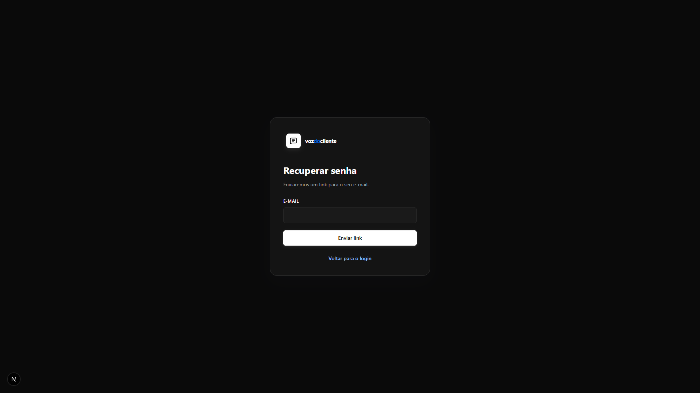
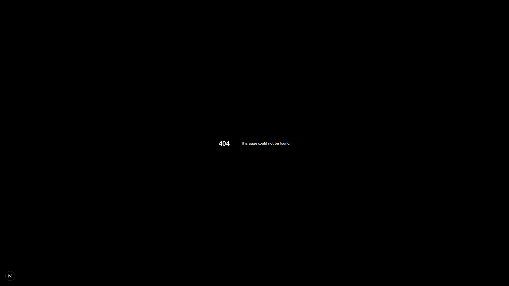
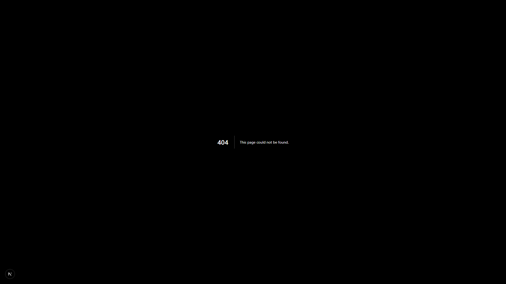

This is a [Next.js](https://nextjs.org) project bootstrapped with [`create-next-app`](https://nextjs.org/docs/app/api-reference/cli/create-next-app).

## Getting Started

Configure o Supabase conforme a seção **Login e gerenciamento de conta** abaixo. Depois, execute:

```bash
npm run dev
# or
yarn dev
# or
pnpm dev
# or
bun dev
```

Open [http://localhost:3000](http://localhost:3000) with your browser to see the result.

You can start editing the page by modifying `app/page.tsx`. The page auto-updates as you edit the file.

This project uses [`next/font`](https://nextjs.org/docs/app/building-your-application/optimizing/fonts) to automatically optimize and load [Geist](https://vercel.com/font), a new font family for Vercel.

## Telas da aplicação

### Login

<p align="center">
  
</p>

*A tela de login permite entrar com e-mail e senha, recuperar a senha ou acessar o cadastro.*

### Cadastro

<p align="center">
  
</p>

*A tela de cadastro reúne nome, e-mail, senha e confirmação de senha para criar uma conta.*

### Recuperação de senha

<p align="center">
  
</p>

*A tela de recuperação de senha solicita o e-mail cadastrado e envia um link para redefinição.*

### Redefinição de senha

<p align="center">
  
</p>

*A tela de redefinição permite informar uma nova senha e confirmá-la antes de salvar.*

### Visão geral

<p align="center">
  
</p>

*A visão geral apresenta indicadores e pesquisas cadastradas pela conta.*

### Pesquisas

<p align="center">
  
</p>

*A tela de pesquisas permite criar, buscar e filtrar pesquisas, adicionar perguntas, ativar ou encerrar pesquisas e copiar o link público.*

### Respostas

<p align="center">
  
</p>

*A tela de respostas apresenta as respostas anônimas, com busca e filtro por pesquisa.*

### Relatórios

<p align="center">
  
</p>

*A tela de relatórios consolida indicadores e a distribuição das avaliações recebidas.*

### Configurações

<p align="center">
  
</p>

*A tela de configurações reúne perfil, senha, notificações e preferências de privacidade.*

## Executar com Docker

Com Docker e Docker Compose instalados, execute na pasta `sistema-web`:

```bash
docker compose --env-file .env.local up --build -d
```

O container de desenvolvimento estará em [http://localhost:3000](http://localhost:3000), com hot reload para alterações em `src` e `public`. O monitoramento usa polling para detectar alterações em pastas compartilhadas no Docker Desktop. Após alterar dependências em `package.json` ou `package-lock.json`, execute o mesmo comando novamente para reconstruir a imagem. As alterações em `next.config.ts` e `tsconfig.json` também ficam disponíveis no container; reinicie-o se necessário.

Para acompanhar os logs ou parar o container:

```bash
docker compose logs -f web
docker compose down
```

## Testes automatizados

Os testes unitários usam o test runner nativo do Node.js e cobrem a validação de dados da conta, filtragem e operações de pesquisas e resultados. Requerem Node.js 22.18 ou superior.

Execute todos os testes na raiz do projeto:

```bash
npm test
```

Os casos estão em `tests/`. A verificação completa de cadastro, login, confirmação de e-mail e recuperação de senha exige um projeto Supabase configurado.

Para executar a versão de produção, sem hot reload, use a configuração separada. Os dois modos usam a porta 3000 e não podem rodar ao mesmo tempo:

```bash
docker compose --env-file .env.local -f compose.production.yaml up --build -d
docker compose -f compose.production.yaml down
```

## Login e gerenciamento de conta

1. Crie um projeto no Supabase e habilite autenticação por e-mail e senha, cadastro público e confirmação de e-mail em Authentication. Configure um provedor SMTP adequado para produção.
2. Copie `.env.example` para `.env.local` e informe a URL e as chaves do Supabase, a origem do site em `SITE_URL` e as chaves do Cloudflare Turnstile. A chave secreta do Supabase é usada exclusivamente no servidor para o envio verificado e nunca deve ser exposta ao navegador. Em produção, use a origem HTTPS pública, sem caminho final.
3. Em Authentication > URL Configuration, configure a Site URL com a mesma origem e permita os redirects `http://localhost:3000/auth/callback` e `http://localhost:3000/auth/callback?flow=recovery` (ou os endereços equivalentes de produção).
4. Execute `npm install` e `npm run dev`. Acesse `/cadastro` para criar uma conta; confirme o e-mail e abra o link no **mesmo navegador** que iniciou o cadastro. O mesmo requisito vale para a recuperação de senha, pois o fluxo usa PKCE.

O painel exige sessão validada no servidor. Em Configurações é possível editar nome e organização e alterar a senha; o botão Sair encerra a sessão. O e-mail é somente leitura. Caso o Supabase exija reautenticação para alteração de senha, siga as políticas configuradas no projeto. Redirecionamentos inválidos ou expirados exigem nova solicitação.

Novas pesquisas têm uma pergunta obrigatória de avaliação de 1 a 5 e uma pergunta de comentário opcional. O criador pode alterar os textos antes da primeira resposta; após isso, pode criar uma nova versão como rascunho separado, preservando as respostas anteriores. Pesquisas antigas mantêm seus tipos de pergunta. As notas entram na média e no percentual de notas 4 e 5; comentários não alteram esses indicadores. O relatório geral reúne todas as avaliações, inclusive as de versões e pesquisas diferentes.

**Limitações:** a API usa o banco Supabase após a aplicação das migrações descritas abaixo. Perguntas e opções não podem ser alteradas após o primeiro envio. Não há papéis ou isolamento de organizações, e as preferências de notificações e privacidade são demonstrativas. O Turnstile verifica cada envio sem uma cota compartilhada por pesquisa, mas não garante ausência de bloqueios ou disponibilidade durante picos. A API limita cada corpo a 5.000.000 bytes. Configure proteção contra tráfego volumétrico e limites apropriados na hospedagem e no Supabase: leituras públicas, identificadores desconhecidos e requisições à aplicação não têm limite por IP. Consulte [a integração](SUPABASE_INTEGRATION.md).

## Banco de dados

As migrações em `supabase/migrations/` definem as tabelas, políticas RLS e funções para leitura e envio público. Cada conta autenticada acessa apenas suas próprias pesquisas e resultados. Envios não armazenam nome, e-mail ou conta do respondente; o conteúdo livre pode, ainda assim, conter dados pessoais.

O envio valida disponibilidade, obrigatoriedade, tipos e opções em uma transação. As perguntas e opções ficam bloqueadas após o primeiro envio; exclusões de pesquisas ou contas removem os dados associados. Migrações pendentes devem ser aplicadas no projeto correto antes de usar a API.

Para aplicá-la, use uma conta autorizada na CLI do Supabase. Na raiz do projeto:

```bash
npx --yes supabase login
npx --yes supabase link
npx --yes supabase db push --remote --dry-run
npx --yes supabase db push --remote
```

No comando `link`, escolha o projeto correto e forneça a senha do banco quando solicitada no terminal, sem compartilhá-la no chat. Revise a prévia antes de confirmar a aplicação. A chave publicável não concede acesso administrativo ao banco. Consulte a [documentação de migrações](https://supabase.com/docs/guides/deployment/database-migrations) e teste o isolamento entre contas em um projeto de teste antes de aplicar em produção.

## Learn More

To learn more about Next.js, take a look at the following resources:

- [Next.js Documentation](https://nextjs.org/docs) - learn about Next.js features and API.
- [Learn Next.js](https://nextjs.org/learn) - an interactive Next.js tutorial.

You can check out [the Next.js GitHub repository](https://github.com/vercel/next.js) - your feedback and contributions are welcome!

## Deploy on Vercel

The easiest way to deploy your Next.js app is to use the [Vercel Platform](https://vercel.com/new?utm_medium=default-template&filter=next.js&utm_source=create-next-app&utm_campaign=create-next-app-readme) from the creators of Next.js.

Check out our [Next.js deployment documentation](https://nextjs.org/docs/app/building-your-application/deploying) for more details.
