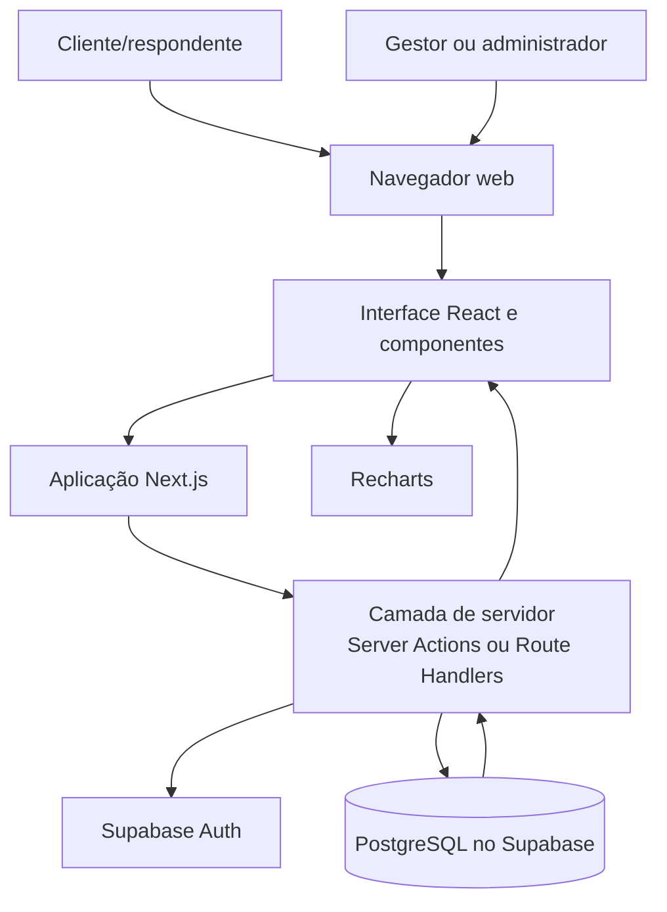
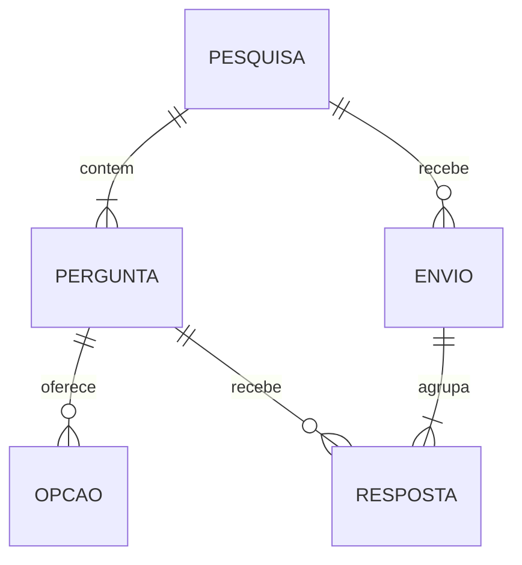
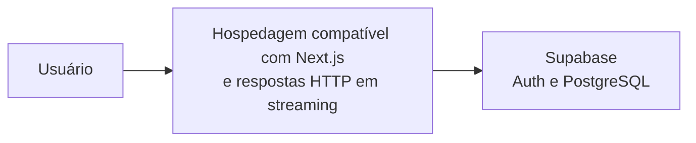

# Levantamento de Arquitetura

## 1. Objetivo

Este documento apresenta a arquitetura proposta para o **Sistema Web para Pesquisa de Satisfação e Análise da Experiência do Cliente**. A arquitetura está alinhada aos requisitos descritos em `requisitos.md` e às tecnologias propostas em `stack.md`.

> **Situação atual:** autenticação, API, formulário público, persistência Supabase/PostgreSQL e indicadores sobre respostas registradas estão implementados. O painel atualiza resultados por Supabase Realtime encaminhado via SSE. Dados fictícios existem para demonstração e em capturas de tela; não são a fonte do painel conectado ao banco. As seções e diagramas abaixo descrevem a arquitetura conceitual e podem incluir evoluções ainda não implementadas. Para o comportamento atual, consulte [fluxo-dados.md](./fluxo-dados.md) e [BACKEND_STATUS.md](./BACKEND_STATUS.md).

## 2. Estilo arquitetural

Recomenda-se uma arquitetura de **monólito modular**. A aplicação será mantida em um único projeto Next.js, organizado em módulos com responsabilidades distintas. A interface e as operações de servidor pertencem à mesma aplicação, enquanto o Supabase fornece os serviços gerenciados de autenticação e banco de dados PostgreSQL.

Essa escolha evita a complexidade operacional de microsserviços e permite separar responsabilidades sem impedir uma futura evolução da solução.

### Princípios adotados

- Separação entre apresentação, regras de negócio e acesso a dados.
- Validação de entrada tanto na interface, para orientar o usuário, quanto no servidor, como proteção efetiva.
- Autorização aplicada no servidor e reforçada pelas políticas do banco de dados.
- Acesso público limitado às informações e operações necessárias para responder a uma pesquisa.
- Persistência relacional para manter a integridade entre pesquisas, perguntas e respostas.

## 3. Visão lógica da arquitetura



O diagrama representa os principais componentes e suas relações. Recharts é utilizado na interface administrativa para visualizar dados consolidados; não é um serviço separado da aplicação.

## 4. Componentes e responsabilidades

| Componente | Responsabilidades |
|---|---|
| Interface pública | Exibir uma pesquisa ativa, permitir o preenchimento das perguntas e apresentar a confirmação do envio. |
| Interface administrativa | Permitir autenticação, gerenciamento de pesquisas e consulta dos resultados. |
| Camada de servidor Next.js | Validar solicitações, verificar permissões e regras de negócio, coordenar operações e retornar somente os dados necessários. |
| Supabase Auth | Autenticar usuários administrativos e fornecer a identidade da sessão. |
| PostgreSQL | Persistir pesquisas, perguntas, opções, envios e respostas, mantendo suas relações. |
| Recharts | Exibir indicadores consolidados em gráficos no painel administrativo. |
| Vitest e Playwright | Verificar regras isoladas e os fluxos principais da aplicação. |

### Organização lógica sugerida no projeto

```text
src/
  app/
    (public)/
      pesquisa/[slug]/
    (admin)/
      login/
      dashboard/
      pesquisas/
      resultados/
    api/                 # Route Handlers, se necessários
  components/
  features/
    surveys/
    responses/
    analytics/
    auth/
  lib/
    supabase/
    validation/
  server/
    services/
    repositories/
```

A estrutura é uma sugestão lógica, não uma exigência de pastas. O projeto deve evitar duplicar regras entre páginas e operações de servidor; regras reutilizáveis devem ficar em módulos de serviço ou domínio.

## 5. Módulos funcionais

### 5.1 Autenticação e autorização

- Login de usuários administrativos pelo Supabase Auth.
- Proteção das páginas e operações administrativas.
- Verificação de autorização no servidor; ocultar um botão na interface não é suficiente para proteger uma operação.
- No escopo inicial, não é necessário permitir que respondentes criem contas.

### 5.2 Gerenciamento de pesquisas

- Criar, editar, ativar, desativar e encerrar pesquisas.
- Definir título, descrição e período de disponibilidade, quando aplicável.
- Configurar perguntas e indicar se são obrigatórias.
- Gerar ou atribuir um identificador público difícil de adivinhar (slug) para o link da pesquisa.

### 5.3 Resposta pública

- Consultar somente pesquisas publicadas e dentro do período de disponibilidade.
- Exibir os tipos de pergunta contemplados pelo escopo: escala, múltipla escolha e resposta aberta.
- Enviar respostas por uma operação de servidor.
- Revalidar no servidor o estado da pesquisa, a estrutura das perguntas e os campos obrigatórios antes de persistir.
- Exibir confirmação somente após o registro bem-sucedido.

### 5.4 Resultados e indicadores

- Consultar os resultados por pesquisa.
- Apresentar quantidade de respostas e consolidações de perguntas fechadas.
- Permitir a leitura de respostas abertas a usuários autorizados.
- Aplicar filtros por período quando essa funcionalidade estiver implementada.
- Calcular indicadores de maneira consistente, usando os dados persistidos e regras documentadas.

## 6. Modelo de dados conceitual

O modelo inicial pode conter as entidades abaixo:

| Entidade | Atributos conceituais | Relacionamentos |
|---|---|---|
| Usuário administrativo | Identificador do Supabase Auth e dados mínimos de perfil | Cria e gerencia pesquisas conforme as permissões definidas. |
| Pesquisa | Identificador, título, descrição, slug público, estado, datas de disponibilidade e indicação de anonimato | Possui várias perguntas e vários envios. |
| Pergunta | Identificador, pesquisa, texto, tipo, obrigatoriedade e ordem de exibição | Pertence a uma pesquisa; pode possuir opções. |
| Opção | Identificador, pergunta, texto/valor e ordem | Pertence a uma pergunta de múltipla escolha. |
| Envio | Identificador, pesquisa e data/hora de recebimento | Pertence a uma pesquisa e agrupa respostas. |
| Resposta | Identificador, envio, pergunta e valor respondido | Associa um envio a uma pergunta. |

### Relacionamentos principais



O esquema físico deverá definir tipos, chaves primárias e estrangeiras, restrições e índices. Por exemplo, a resposta deve referenciar uma pergunta pertencente à mesma pesquisa do envio; essa consistência deve ser garantida pelas regras de persistência, e não apenas pela interface.

No escopo anônimo, o envio não precisa armazenar nome, e-mail ou outro identificador pessoal do respondente. Se for necessário identificar respondentes ou suportar várias organizações com isolamento entre clientes, o modelo deverá ser revisto antes da implementação.

## 7. Fluxos arquiteturais principais

Os passos representam o fluxo implementado em alto nível. A análise detalhada das entradas, alterações, validações, falhas e indicadores está em [fluxo-dados.md](./fluxo-dados.md). O sistema permite criar uma nova versão como pesquisa separada; o original e suas respostas são preservados.

### 7.1 Criação e publicação de pesquisa

1. O gestor autentica-se.
2. A interface envia os dados da pesquisa à camada de servidor.
3. O servidor valida o formato dos dados e confirma a sessão e a permissão do usuário.
4. O servidor aplica as regras de negócio e persiste pesquisa, perguntas e opções no PostgreSQL.
5. Ao publicar, o sistema define o estado e, se aplicável, o período de disponibilidade.
6. A interface apresenta a confirmação e o link público.

### 7.2 Resposta a uma pesquisa

1. O cliente abre o link público.
2. A aplicação consulta no servidor os dados públicos da pesquisa.
3. O servidor verifica se a pesquisa existe, está ativa e se está dentro do período configurado.
4. A interface apresenta apenas título, descrição e perguntas necessários à resposta.
5. O cliente preenche e envia o formulário.
6. O servidor valida novamente pesquisa, perguntas, opções e obrigatoriedade.
7. O servidor registra o envio e suas respostas no banco de dados.
8. Após confirmação do banco, a aplicação informa que a resposta foi registrada.

O registro do envio e de suas respostas deve ser atômico: se uma parte falhar, não deve permanecer um envio parcialmente gravado. Isso pode ser implementado com uma transação ou mecanismo equivalente no PostgreSQL.

### 7.3 Consulta de resultados

1. O gestor autentica-se e seleciona uma pesquisa.
2. O servidor verifica a sessão e a autorização.
3. O servidor consulta e agrega as respostas, aplicando os filtros solicitados.
4. A interface recebe somente os dados necessários para tabelas e gráficos.
5. A interface apresenta totais, distribuições, médias e respostas abertas conforme o escopo.

## 8. Segurança e privacidade arquiteturais

- A chave pública do Supabase pode ser utilizada no cliente apenas com políticas de acesso adequadas. A chave de serviço (service role) é exclusivamente de servidor e nunca deve ser enviada ao navegador.
- A camada de servidor deve validar toda operação; dados enviados pelo navegador são considerados não confiáveis.
- As políticas de segurança em nível de linha do PostgreSQL (RLS) devem restringir o acesso conforme os papéis e as operações autorizadas.
- O acesso público deve permitir apenas obter informações de pesquisas publicadas e enviar respostas válidas. Não deve permitir leitura pública de respostas, relatórios ou dados administrativos.
- O sistema deve armazenar somente os dados necessários para a finalidade definida. A anonimização precisa considerar também identificadores indiretos e metadados, não apenas a ausência de nome.
- Mensagens de erro públicas não devem revelar detalhes internos, credenciais ou informações de outras pesquisas.
- Credenciais e configurações sensíveis devem ser armazenadas como variáveis de ambiente nos ambientes apropriados.
- Devem ser avaliados mecanismos contra envios automatizados e abusivos caso a pesquisa seja pública e acessível sem autenticação.

## 9. Implantação e ambientes



Ambientes recomendados:

- **Desenvolvimento:** execução local da aplicação e uso de projeto ou ambiente separado para testes.
- **Produção/demonstração:** aplicação publicada em hospedagem compatível com a saída standalone do Next.js e conexões SSE, conectada ao projeto Supabase correspondente. O repositório também contém Docker Compose de produção.

As configurações de cada ambiente devem ser separadas. Migrações e alterações do esquema devem ser registradas e aplicadas de forma controlada. Dados reais de clientes não devem ser usados em testes sem autorização e medidas apropriadas de proteção.

## 10. Decisões e limites do escopo inicial

| Decisão | Justificativa |
|---|---|
| Monólito modular em Next.js | Reduz complexidade de implantação e mantém responsabilidades separadas. |
| PostgreSQL relacional | Adequado às relações entre pesquisas, perguntas, envios e respostas. |
| Respondente sem login | Reduz atrito para responder e está alinhado ao acesso por link público. |
| Autenticação apenas administrativa | Restringe a criação e a análise de pesquisas a usuários autorizados. |
| Processamento de respostas no servidor | Permite validar o estado da pesquisa e as regras antes de persistir. |
| Sem microsserviços na primeira versão | Não há, no escopo atual, necessidade que justifique a complexidade adicional. |

As decisões sobre anonimato, identificação dos respondentes e operação para uma ou várias organizações ainda precisam ser confirmadas. A arquitetura acima assume como ponto de partida pesquisas acessadas por link e sem coleta de identificação pessoal, sem suporte multiempresa como requisito da primeira versão.

## 11. Atributos de qualidade e validação

- **Segurança:** testar que usuários não autenticados não acessam a área administrativa e que respondentes não consultam respostas ou relatórios.
- **Integridade:** testar que pesquisas encerradas não recebem envios e que cada resposta corresponde a uma pergunta válida da pesquisa.
- **Usabilidade:** verificar os fluxos em telas móveis e desktop e apresentar mensagens claras de validação.
- **Desempenho:** avaliar consultas de consolidação com um conjunto de dados representativo do volume esperado no TCC.
- **Manutenibilidade:** manter regras de negócio testáveis sem depender da interface e documentar o esquema e as políticas de acesso.
- **Confiabilidade:** testar falhas no envio e garantir que uma confirmação só seja apresentada após a persistência completa das respostas.

## 12. Texto para inclusão no trabalho acadêmico

> A arquitetura proposta para o sistema é a de um monólito modular, implementado com Next.js, React e TypeScript. A aplicação concentra as interfaces pública e administrativa, bem como as operações de servidor responsáveis por validar solicitações, aplicar regras de negócio e acessar os dados. O Supabase será utilizado para autenticação dos usuários administrativos e para disponibilizar o banco de dados PostgreSQL. O modelo conceitual contempla pesquisas, perguntas, opções, envios e respostas. O acesso às pesquisas públicas será limitado às informações necessárias para o preenchimento, enquanto a consulta de resultados e o gerenciamento serão restritos a usuários autenticados e autorizados. Essa abordagem busca equilibrar simplicidade de desenvolvimento, integridade dos dados e possibilidade de evolução futura.
