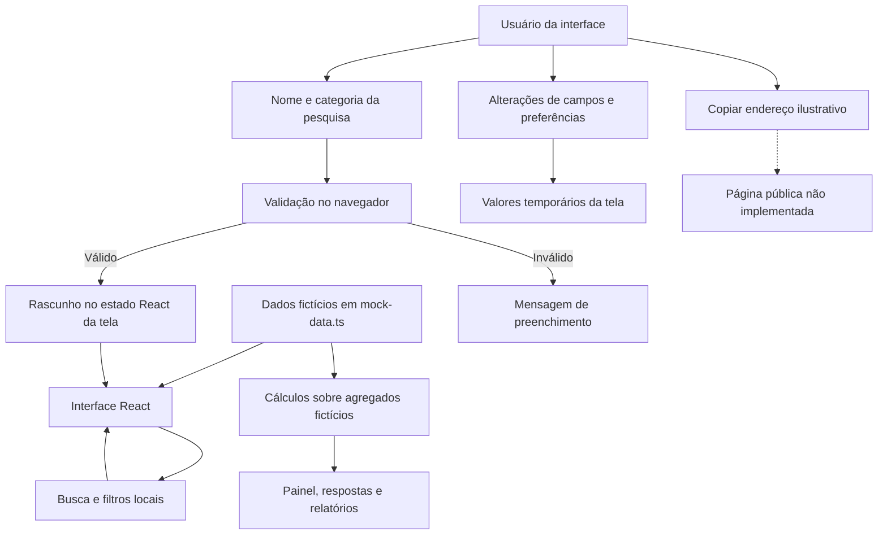
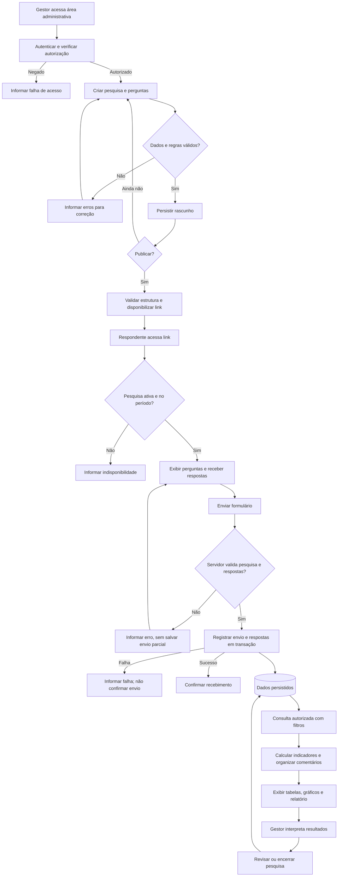
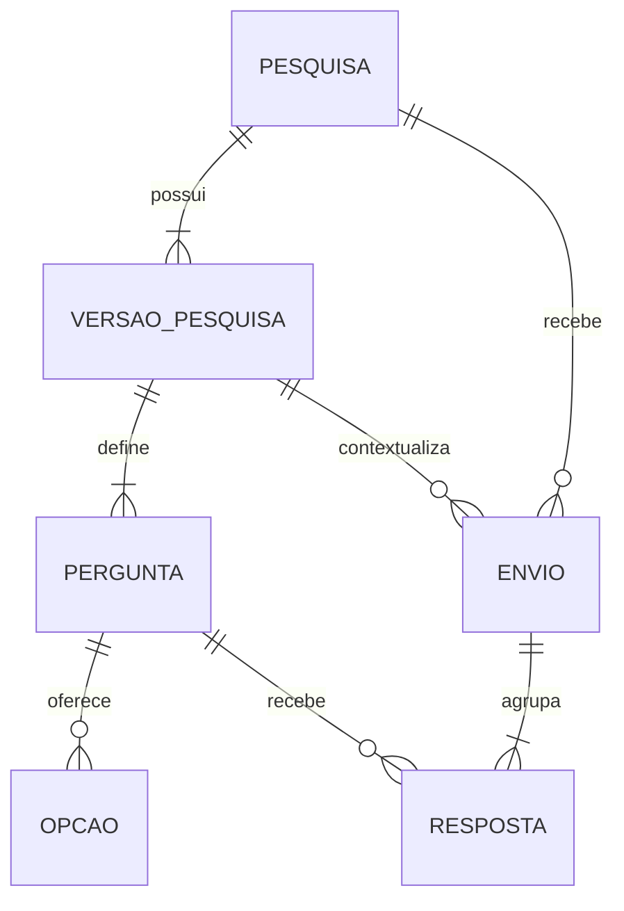

# Fluxo de uso e ciclo de vida dos dados

**Sistema:** Pesquisa de Satisfação e Análise da Experiência do Cliente  
**Natureza:** revisão do funcionamento atual e especificação proposta para a evolução do sistema.

## 1. Objetivo e leitura do documento

Este documento descreve como as informações entram no sistema, são validadas, modificadas, armazenadas e transformadas em indicadores. Ele complementa [requisitos.md](./requisitos.md), [arquitetura.md](./arquitetura.md) e [stack.md](./stack.md).

Há duas situações distintas:

- **Implementado atualmente:** interface administrativa com dados fictícios e alterações temporárias em memória no navegador.
- **Proposto:** fluxo futuro com autenticação, coleta pública, validação no servidor, banco de dados e indicadores calculados a partir dos dados registrados. Nenhuma dessas funcionalidades futuras deve ser entendida como implementada apenas por aparecer nos diagramas.

## 2. Atores e informações envolvidas

| Ator | Entrada ou ação | Uso esperado |
|---|---|---|
| Administrador | Autenticação, dados de perfil e configurações | Gerenciar o acesso e as preferências administrativas. |
| Gestor ou analista | Dados da pesquisa, perguntas, opções, alterações de estado e filtros | Criar e acompanhar pesquisas e analisar resultados. |
| Cliente/respondente | Acesso ao link e preenchimento de respostas | Informar a experiência vivida por meio de notas, escolhas e comentários. |
| Sistema | Validações, registros, agregações e exibição | Preservar a integridade dos dados e apoiar a análise dos resultados. |

As informações tratadas podem ser agrupadas em:

1. **Configuração da pesquisa:** título, descrição, categoria, estado, período, perguntas, tipos e opções.
2. **Envio:** ocorrência de uma resposta concluída, vinculada a uma pesquisa e recebida em determinada data e hora.
3. **Resposta:** valor fornecido a uma pergunta dentro de um envio; pode ser uma nota, uma opção ou um texto.
4. **Indicadores:** resultados derivados dos envios e das respostas, por exemplo, totais, médias e distribuições.
5. **Dados administrativos e operacionais:** identidade autorizada, configurações e eventos necessários à operação e à auditoria.

## 3. Fluxo implementado hoje

### 3.1 Origem e processamento

- Os conjuntos de pesquisas, respostas individuais de exemplo, série semanal e distribuição de notas estão em [mock-data.ts](./sistema-web/src/lib/mock-data.ts). São dados definidos no código, não obtidos de clientes nem de um banco.
- A visão geral, as respostas e os relatórios usam agregados e listas desses conjuntos. Os gráficos são renderizados na interface com Recharts.
- A busca e os filtros de pesquisas e respostas são executados localmente no navegador e alteram somente o que é exibido; não modificam os dados de origem. O sentimento já vem atribuído a cada resposta fictícia: não existe análise automática de texto.
- A seção de relatórios apresenta uma série rotulada como últimos sete dias, porém os valores são fixos, não uma consulta por datas reais. Outros indicadores nela exibidos são agregados gerais; não se deve pressupor que todos pertencem ao período do gráfico.
- A impressão usa a função de impressão do navegador. Não há exportação estruturada dos dados ou geração de arquivo de relatório no servidor.

### 3.2 Entrada e alteração na interface atual

| Ação | Tratamento efetivamente realizado | Persistência ou consequência |
|---|---|---|
| Criar rascunho | Exige nome e categoria, limita os campos a 80 e 40 caracteres, remove espaços nas extremidades e cria um objeto com estado `Rascunho` e identificador baseado no horário. | Acrescenta o objeto ao estado da seção de pesquisas; não cria perguntas, não chama servidor e não grava no banco. |
| Navegar entre seções ou recarregar | A seção selecionada é controlada pelo estado da página; a seção de pesquisas é desmontada ao sair dela. | O rascunho local deixa de existir ao sair da seção ou recarregar; o contador da navegação e os indicadores gerais não são sincronizados com ele. |
| Copiar link | Copia uma URL construída com a origem atual e o identificador da pesquisa. | A rota pública não existe; copiar o endereço não publica a pesquisa nem permite receber respostas. |
| Editar dados de perfil e preferências | Campos são alterados na tela e os interruptores mudam o estado local. O botão de salvar apenas mostra uma confirmação temporária. | Não há armazenamento, atualização do perfil global, envio de notificações ou aplicação da preferência de anonimato. Valores são perdidos ao sair da seção ou recarregar. |
| Consultar respostas | Filtra as oito respostas individuais de exemplo por texto, pesquisa e sentimento; detalhes são expandidos localmente. | Não há coleta, edição ou exclusão de respostas reais. O total mostrado é um agregado separado, não o tamanho da lista. |
| Imprimir relatório | Solicita a impressão da página atual pelo navegador. | O resultado depende da configuração e da confirmação do usuário no diálogo de impressão. |

**Consequência importante:** textos de confirmação na interface não comprovam que houve gravação. Antes de usar o sistema com dados reais, as ações precisam ser conectadas a uma camada persistente e suas confirmações devem refletir o resultado efetivo.

### 3.3 Indicadores e limites dos dados mock

| Indicador | Cálculo ou origem atual | Limitação |
|---|---|---|
| Total de respostas | Soma de `responses` das pesquisas: **1.007**. | É um agregado de exemplo; há apenas oito respostas individuais na lista, que não sustentam esse total. |
| Pesquisas ativas | Quantidade de pesquisas com estado `Ativa`: **5**. | Base fixa; não há operação para alterar estados. |
| Satisfação média | Soma de `responses × score` por pesquisa dividida pelo total: aproximadamente **4,688**, exibida como **4,7/5**. | Usa médias por pesquisa já agregadas. A média calculada pela distribuição de estrelas é aproximadamente **4,674**: as fontes não são exatamente consistentes, embora ambas arredondem para 4,7. |
| Conclusão média | Média aritmética dos percentuais das cinco pesquisas ativas: **67,6%**, exibida como **68%**. | Os percentuais são pré-definidos; não há registros de início de formulário para calcular conclusão. Não é uma taxa global ponderada. |
| Notas 4 e 5 | Soma dos percentuais previamente arredondados: **19% + 75% = 94%**. | Pelas contagens, 950/1.007 ≈ **94,34%**. A regra de arredondamento deve ser definida para dados reais. |
| Evolução semanal | Série fixa: **348** respostas contra **301** no período anterior; variação ≈ **15,6%**. | Não é calculada a partir das respostas individuais nem de datas de envio. |

Essas bases foram criadas separadamente. A coincidência de alguns totais não demonstra rastreabilidade entre uma resposta individual, os gráficos e os demais indicadores.

## 4. Fluxo de uso proposto de ponta a ponta

O fluxo pressupõe autenticação administrativa e resposta pública sem login, conforme a proposta de arquitetura. A política de anonimato e o suporte a múltiplas organizações continuam pendentes de decisão.

## 5. Entrada, validação e armazenamento propostos

### 5.1 Criação e publicação

1. O gestor acessa a área administrativa. O servidor valida a sessão e a permissão para a operação.
2. O gestor informa título, descrição e demais atributos necessários, adiciona perguntas e, para múltipla escolha, suas opções.
3. A interface orienta o preenchimento. O servidor valida novamente os campos, tipos, limites, ordem, perguntas obrigatórias e consistência das opções.
4. O servidor salva a pesquisa como rascunho e retorna a confirmação somente depois da persistência.
5. Antes da publicação, verifica-se que há ao menos uma pergunta válida, que os campos obrigatórios estão definidos e que o período configurado, se houver, é coerente.
6. A operação autorizada torna a pesquisa ativa e disponibiliza o link público. Caso uma etapa falhe, o servidor informa o erro sem afirmar que a publicação ocorreu.

### 5.2 Acesso e envio do respondente

1. O respondente acessa o link e o servidor verifica a existência da pesquisa, seu estado e seu período. A resposta pública deve conter apenas as informações necessárias ao preenchimento.
2. O formulário informa claramente se há identificação pessoal e qual o propósito da coleta. Se a pesquisa estiver indisponível, o envio não é aceito.
3. O respondente preenche as perguntas. A interface valida os campos para facilitar a correção, mas não é a fonte de segurança.
4. Ao receber o envio, o servidor valida novamente o estado e a disponibilidade, pertencimento das perguntas à pesquisa, obrigatoriedade, tipos e faixas de notas, opções permitidas e limites de texto.
5. O servidor registra um **envio** e suas **respostas** em uma única transação. Todos os registros são gravados ou nenhum é gravado.
6. A disponibilidade deve ser verificada de forma consistente com a transação, para impedir que um envio seja aceito após um encerramento concorrente.
7. Apenas após o commit bem-sucedido é apresentada a confirmação. Em falha ou validação inválida, a interface preserva o preenchimento quando possível e informa como prosseguir.

Reenvios por duplicidade de clique, falhas de rede e múltiplas respostas por uma mesma pessoa exigem políticas próprias. Um mecanismo de idempotência por tentativa pode evitar gravações duplicadas em reenvios técnicos, mas não prova que uma pessoa respondeu apenas uma vez; essa regra depende do modelo de identificação escolhido.

### 5.3 Estrutura conceitual e vínculos

Esta é uma proposta conceitual para preservar o significado histórico das respostas, não um esquema físico implementado. Cada envio deve referenciar a versão apresentada ao respondente; cada resposta deve apontar para uma pergunta dessa versão; cada opção escolhida deve pertencer à pergunta. O desenho físico, incluindo restrições e tratamento de perguntas opcionais ou múltiplas seleções, deve ser definido na implementação.

## 6. Alteração e ciclo de vida das informações

### 6.1 Pesquisa e perguntas

| Situação | Ação proposta | Efeito e proteção |
|---|---|---|
| Rascunho | Criar e editar título, descrição, perguntas e opções. | Alterações são autorizadas, validadas e persistidas; o rascunho não recebe respostas. |
| Publicação | Validar a pesquisa e ativá-la. | A versão publicada passa a ser a referência dos envios. Só há link utilizável após publicação. |
| Ativa | Receber respostas válidas e consultar resultados. | Não alterar retroativamente o significado de perguntas, opções ou escalas associadas a respostas já registradas. |
| Alteração de estrutura publicada | Criar nova versão imutável para novas respostas, mantendo as anteriores, ou bloquear a alteração e exigir nova pesquisa. | Decisão de implementação pendente. Evita interpretar respostas antigas com perguntas novas. |
| Encerrada | Impedir novos envios e manter resultados para análise. | Preservar o histórico; eventual reabertura deve ser uma decisão explícita com regras próprias. |
| Exclusão | Definir previamente quem pode excluir, quais dados são afetados e o tratamento legal aplicável. | Não presumir exclusão automática ou permanente; oferecer confirmação e respeitar retenção e solicitações aplicáveis. |

Estado e período são verificações independentes: uma pesquisa ativa fora de sua janela de disponibilidade não deve receber respostas. A identidade usada no link não substitui autorização administrativa nem controles contra abuso.

### 6.2 Respostas, configurações e indicadores

- **Respostas enviadas:** a proposta inicial não prevê edição pelo gestor. Se correção ou exclusão forem necessárias, definir responsável, justificativa, histórico e efeitos nos indicadores antes de implementar. Não alterar silenciosamente valores originais.
- **Configurações:** validar e persistir no servidor somente as preferências realmente suportadas. Confirmações de salvamento dependem da conclusão da operação. Notificações só podem ser consideradas funcionais quando houver serviço de entrega e política de destinatários.
- **Indicadores:** não são a fonte primária; são derivados das respostas elegíveis. Uma alteração ou exclusão autorizada de dados que os afetem deve refletir-se no próximo cálculo ou invalidar um eventual cache. Atualização instantânea não é assumida sem implementação específica.
- **Histórico e auditoria:** registrar operações administrativas relevantes, autor, data/hora, objeto e resultado, conforme a necessidade e a política de retenção. Evitar credenciais, conteúdo integral das respostas e dados pessoais desnecessários em logs.

## 7. Análise e regras de cálculo propostas

Os indicadores devem ser calculados sobre uma **população explicitamente definida**: pesquisas e versões selecionadas, período e fuso horário informados, envios válidos e perguntas compatíveis. Filtros devem afetar de forma consistente os números, gráficos e respostas exibidos; qualquer indicador global não filtrado deve ser identificado como tal.

| Indicador | Definição proposta | Cuidados |
|---|---|---|
| Total de envios | Contagem dos envios concluídos e válidos no conjunto filtrado. | Contar envios, não o número de respostas individuais; identificar exclusões e versões. |
| Distribuição por opção ou nota | Quantidade e percentual de respostas válidas para cada opção ou nota da pergunta selecionada. | Denominador: respostas válidas daquela pergunta, não necessariamente todos os envios, pois perguntas podem ser opcionais. |
| Média de avaliação | Soma das notas válidas dividida pelo número de notas válidas na mesma escala e pergunta, ou em perguntas explicitamente comparáveis. | Não combinar escalas diferentes sem regra de normalização. Sem notas válidas, apresentar “sem dados”, não zero. |
| Percentual de notas 4 e 5 | `(quantidade de notas 4 ou 5 ÷ quantidade de notas válidas na escala de 1 a 5) × 100`. | Exibir base e regra de arredondamento; não chamar automaticamente o resultado de CSAT sem definição metodológica. |
| Evolução temporal | Contar envios válidos por dia ou outro intervalo do período selecionado. | Definir fuso horário e intervalos; apresentar também intervalos sem respostas com zero. |
| Variação entre períodos | `((atual - anterior) ÷ anterior) × 100`, comparando intervalos equivalentes. | Se o período anterior for zero, a variação percentual fica indisponível; não dividir por zero nem interpretar como crescimento infinito. |
| Conclusão | Se a coleta de início de formulário for implementada: `(envios concluídos ÷ inícios elegíveis) × 100`. | Ainda não existe registro de início. Definir o que é um início, deduplicação, privacidade e janela de medição; sem denominador confiável, não exibir taxa. |
| Respostas abertas | Listagem de comentários vinculados à pergunta, pesquisa e versão, com filtros autorizados. | A interpretação é humana no escopo inicial; não inferir sentimento de forma automática. |

**Arredondamento recomendado:** calcular a partir das contagens e valores brutos, manter precisão intermediária e arredondar apenas para apresentação, usando a mesma regra em todas as telas. Em perguntas opcionais, distinguir claramente a quantidade de envios da quantidade de respostas à pergunta.

CSAT, NPS e CES exigem perguntas, escalas e fórmulas específicas. Uma pesquisa com “NPS” no nome ou uma média de estrelas não constitui, por si só, cálculo válido de NPS. A definição do indicador a adotar no TCC permanece uma decisão de escopo.

### 7.1 Exemplo de processamento futuro

Para uma pergunta opcional de avaliação de 1 a 5, suponha **10 envios concluídos**, dos quais **8** contêm uma nota válida: quatro notas 5, duas notas 4, uma nota 3 e uma nota 2.

1. O total de envios é **10**; o total de notas válidas é **8**.
2. A média da pergunta é `(4×5 + 2×4 + 1×3 + 1×2) ÷ 8 = 4,125`, apresentada como **4,1/5** com uma casa decimal.
3. A participação de notas 4 e 5 é `(4 + 2) ÷ 8 × 100 = 75%`, com base em oito avaliações.
4. As duas respostas ausentes não entram no denominador de nota, mas continuam fazendo parte do total de envios.

Os números são apenas um exemplo para demonstrar as regras de cálculo, não dados coletados pela aplicação.

## 8. Segurança, privacidade e falhas

- Acesso administrativo e consultas de resultados devem exigir autenticação e autorização verificadas no servidor, reforçadas por políticas de acesso ao banco.
- A interface pública não deve expor respostas de outros clientes, relatórios administrativos ou segredos. A chave de serviço do Supabase permanece somente no servidor.
- O estado e as datas de disponibilidade devem ser revalidados no recebimento do envio. Erros de validação devem apontar os campos corrigíveis; falhas de armazenamento não podem gerar confirmação de sucesso.
- Definir o mínimo de informações pessoais, finalidade, transparência, retenção e tratamento das solicitações de titulares antes de coletar dados reais. Comentários livres e metadados também podem permitir identificação; ausência de nome não garante anonimato.
- Quando houver risco de abuso, definir controles proporcionais para envios automatizados e frequência, sem afirmar que controles anti-duplicidade provam identidade.
- Fazer logs operacionais úteis sem gravar credenciais nem conteúdo sensível desnecessário. A política de backups, retenção e recuperação deve ser definida e testada antes do uso real.
- Se a consulta de resultados falhar, indicar que os dados não puderam ser carregados; não apresentar números antigos ou vazios como se fossem atuais sem identificação.

## 9. Lacunas identificadas e prioridades

| Prioridade | Lacuna | Ação para a evolução |
|---|---|---|
| Alta | Dados fictícios e alterações temporárias, sem autenticação ou persistência. | Implementar identidade administrativa, autorização, modelo de dados e operações de servidor. |
| Alta | Link copiado aponta para uma rota pública inexistente. | Implementar acesso público e só disponibilizar links de pesquisas efetivamente publicadas. |
| Alta | Confirmações de rascunho e configurações não representam gravação. | Vincular confirmação ao resultado persistido e comunicar falhas; enquanto não houver persistência, evitar prometer salvamento permanente. |
| Alta | Não há perguntas, publicação, coleta ou transação de envio. | Implementar os fluxos de criação, validação, publicação e resposta, incluindo testes de concorrência. |
| Alta | Agregados e respostas individuais fictícias são independentes e podem divergir. | Utilizar uma fonte persistida comum e produzir indicadores por consulta ou agregação rastreável. |
| Média | Não há controle de versões de perguntas, política de edição, exclusão ou retenção. | Definir regras e modelagem antes de receber respostas reais. |
| Média | Período do relatório e percentuais são exemplos fixos; não há cálculo de conclusão com base em inícios. | Implementar filtros reais, denominadores e regras de exibição por indicador. |
| Média | Perfis e notificações não executam ações reais; sentimento é pré-definido. | Implementar somente as funcionalidades aprovadas para o escopo e identificar métodos de análise adotados. |
| Média | Exportação estruturada e filtro temporal ainda não existem. | Priorizar conforme RF11 e RF12, distinguindo-os da impressão pelo navegador. |

## 10. Cenários de aceitação para a implementação futura

| Cenário | Resultado esperado |
|---|---|
| Criar pesquisa sem pergunta e tentar publicar | Publicação recusada com mensagem; não é gerado link funcional. |
| Usuário sem autorização tentar alterar uma pesquisa | Operação recusada no servidor; nenhum dado alterado. |
| Acessar ou enviar pesquisa encerrada ou fora do período | Acesso ao formulário de resposta ou envio recusado com mensagem apropriada; nenhum registro é criado. |
| Enviar pergunta obrigatória vazia, opção inválida ou pergunta de outra pesquisa | Servidor recusa o envio e informa os erros sem gravar registros parciais. |
| Falha ao gravar uma resposta durante o envio | A transação é revertida e o respondente não recebe confirmação de sucesso. |
| Encerramento durante um envio concorrente | A regra de consistência definida garante que o envio não seja aceito após o encerramento. |
| Repetir uma tentativa por falha de rede usando a mesma chave de idempotência | A mesma tentativa não gera dois envios; tentativas distintas seguem a política de respostas definida. |
| Filtrar por pesquisa, versão e período | Números, gráficos e comentários usam o mesmo conjunto e informam o período e fuso considerados. |
| Pergunta opcional sem resposta em parte dos envios | A distribuição e a média usam apenas respostas válidas à pergunta; o total de envios permanece separado. |
| Não haver respostas ou o período anterior ser zero | Apresentar “sem dados” ou variação indisponível, conforme o indicador, sem divisão por zero. |
| Alterar pergunta que já recebeu respostas | Bloquear a mudança ou criar nova versão, preservando a interpretação das respostas anteriores. |
| Excluir ou corrigir dados quando permitido | Operação autorizada e auditável, com indicadores recalculados ou cache invalidado conforme a política definida. |
| Responder sem identificação, se essa opção for aprovada | Formulário e armazenamento seguem a política de anonimato, incluindo avaliação de comentários e metadados. |

## 11. Decisões a confirmar

1. Pesquisas serão anônimas ou identificadas? Quais informações e metadados são realmente necessários?
2. O sistema atenderá uma única organização ou várias com isolamento de dados?
3. Uma pessoa pode responder mais de uma vez? Qual controle é viável sem contrariar a política de privacidade?
4. Uma pesquisa ativa pode ser alterada? A solução será versionamento ou criação de uma nova pesquisa?
5. Haverá registro de início de preenchimento para medir conclusão? Qual será o fuso dos relatórios?
6. Quais indicadores e perguntas serão utilizados no TCC? Será necessário CSAT, NPS ou CES?
7. Quais ações de correção, exclusão, exportação, retenção e auditoria pertencem à primeira versão?

## 12. Relação com os requisitos

- **RF01, RF02, RF03 e RF04:** acesso, criação, edição, perguntas e publicação — seções 5.1 e 6.
- **RF05, RF06, RF07, RF13 e RF14 / RN01 a RN04 e RN08:** acesso público, validação, registro e encerramento — seções 4 e 5.2.
- **RF08 a RF12 / RN06:** consultas, filtros, indicadores e relatórios — seções 7 e 9.
- **RN05 e RN07 / RNF04, RNF05 e RNF08:** autorização, transparência e privacidade — seções 5, 6 e 8.

Os cenários da seção 10 são propostas de aceitação para essas funcionalidades; sua presença neste documento não significa que tenham sido implementadas ou testadas.
